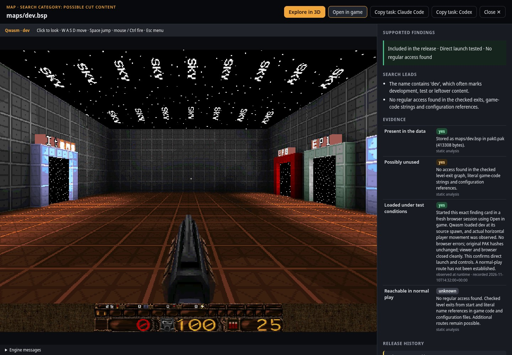
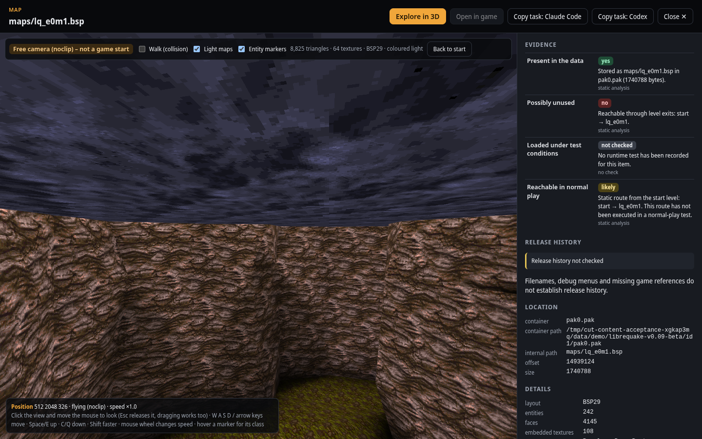
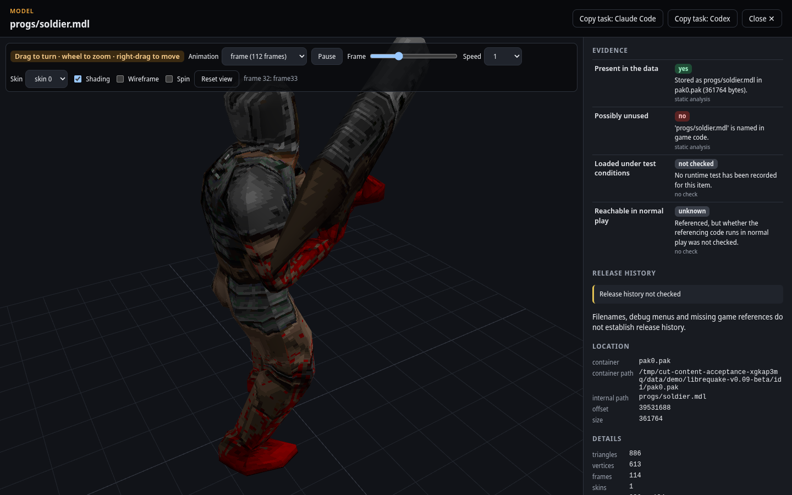

<h1 align="center">Cut Content Anything</h1>

<p align="center"><b>Ask what is hidden in a game you own, and get an answer backed by evidence from its real files and the running game.</b></p>

<p align="center">
<a href="#quick-start">Quick start</a> ·
<a href="#how-it-works">How it works</a> ·
<a href="#what-you-can-investigate">What you can investigate</a> ·
<a href="#directory-of-documented-content">Directory</a> ·
<a href="#share-what-you-find">Contribute</a> ·
<a href="#faq">FAQ</a> ·
<a href="#documentation">Docs</a>
</p>

  

Wondering whether your game still carries a removed level, an unused boss, a
debug menu or a map from its prototype? Give this repository to your AI coding
agent together with your question. It identifies your exact build, researches what is publicly
known, reads the game's real archives (writing a decoder if it has to), shows
what it found in a local 3D gallery, **loads it in the actual game**, and checks
whether it was ever released. Every claim carries its evidence.



## Quick start

Example request for a coding agent that reads `AGENTS.md` (for example Claude Code or Codex):

```
Clone https://github.com/Fluffyattack/cut-content-anything, read AGENTS.md and answer
this about my copy of <game> in <folder>: <question, e.g. "Is there a hidden test level?">
```

Or set it up yourself (Python 3.10+, nothing else to install):

```sh
git clone https://github.com/Fluffyattack/cut-content-anything
cd cut-content-anything
bin/cutcontent doctor              # checks the setup
bin/cutcontent demo librequake     # optional: free LibreQuake data, about 56 MB, checksum-verified
bin/cutcontent gui                 # gallery on http://127.0.0.1:8749/
```

Agents work from [AGENTS.md](AGENTS.md) and the phase skills in [`skills/`](skills)
(synced to `.claude/skills` for Claude Code and `.agents/skills` for Codex).
Claude Code also picks up the project's [MCP server](playbook/mcp.md) from `.mcp.json`.

## AI-assisted development

- **Who wrote it:** this first version (code, tests, demo-data generator and documentation) was
  written by **Claude Code**, Anthropic's coding agent, in an automated session on 2026-11-10,
  following the maintainer's written requirements.
  **Codex** continued development on the same day: real browser-engine integration,
  checks with local disc images, native game execution, a question-led investigation
  skill, source-backed release assessments and shared decoded-map previews.
- **Tools actually used while building it:** Claude Code; Python's `unittest`; Playwright with
  headless Chromium for the browser acceptance run; `npm pack` (only to download three.js);
  git and the GitHub CLI for publishing; Emscripten 4.0.23 and a separate Qwasm build
  for the browser game-start test.
- **Automated testing (done):** unit and integration tests with self-made data
  (`python3 -m unittest discover -s tests -t tests`), plus the browser acceptance run
  `tests/browser_acceptance.py`, which passed with the self-made demo and with LibreQuake v0.09-beta.
  The separate `tests/browser_game_acceptance.py` also loaded LibreQuake's `lq_e0m1`
  and `dev` in the real engine, verified player movement and checked unchanged game-file checksums.
  Additional local scanner checks used 231 file-table cartridges and 30 disc images.
  These scanner checks cover data reading and previews. Separate actual interpreter
  runs tested a local cartridge build's hidden menu, level selection, touch controls
  and game audio, and a local `.cso` build's gameplay, inputs and recorded stereo audio.
  The gallery menu replay matched an independent real framebuffer capture, then
  loaded a level, accepted a drawn bubble and decoded ten seconds of actual sound.
  An independent agent also followed a free-form question into a local game's
  nested archive, decoded a real map and tested rotating, zooming, panning and
  reopening it in the gallery. This establishes a working investigation path;
  it does not establish that the map was unused or unreleased.
- **Human review (not done yet):** no person has reviewed the code so far, and the hands-on
  acceptance test by the maintainer is still pending. Treat 0.1.0 as unreviewed.
- **0.2.0 (2026-11-11, Claude Code):** reorganised around an agent playbook: phase map
  in `AGENTS.md`, nine phase skills, a playbook, game write-ups, a source-backed
  directory of documented content with a generator and validator, contribution
  templates and an MCP server. Tested with the unit suite, a real MCP client
  session and a real browser run of the gallery's directory panel.

## How it works

Triage decides how the investigation starts: checking content someone already
described, or searching a build nobody has documented yet. Both finish the same way.

| | Known claims | Undocumented build |
|---|---|---|
| Starting point | Someone already described hidden content for this game: in the [directory](DIRECTORY.md), a write-up or a public source. | Nothing documented, or your question asks for something new. |
| Method | Turn every claim into a hypothesis for *your exact build*: find the bytes, check references, load it in the game. Upgrade or correct the entry. | Inventory the real archives, decode unknown formats, trace references, search for developer menus, decode maps for the gallery. |
| Skills | `cutcontent-triage`, `cutcontent-research`, `cutcontent-runtime-verification` | `cutcontent-decoder`, `cutcontent-reference-analysis`, `cutcontent-developer-menus` |

Both paths finish with: a documented search for developer functions, **an
actual start of the exact game build with every reported map loaded**, a
source-backed release history, and a pull request back here
(`cutcontent-release-history`, `cutcontent-contribute`). The umbrella skill
`cut-content-anything` routes between them.

### Four statements, never merged

| Statement | Meaning |
| --- | --- |
| Present in the data | The bytes exist at a known location (container, internal path, offset). |
| Possibly unused | Reference analysis found nothing that uses it, with stated coverage. |
| Loaded under test conditions | Seen loading in the actual game, engine or emulator. Only set from real observations. |
| Reachable in normal play | A player gets there without cheats or debug tools, shown by an executed route. |

Release history (shipped in the data? regularly playable? never released?) is
recorded separately with checked sources. A name like `test` or `beta` is a
lead, never a conclusion. More in [the evidence model](playbook/evidence-model.md).

## What you can investigate

| Your game is... | What the tool reads today | What your agent adds |
|---|---|---|
| Quake-engine (PC) | Everything: PAK, BSP, MDL, sprites, sounds, QuakeC; exit graphs; near-miss names; 3D levels; **real game start in the browser** | Nothing needed for the basics |
| A handheld cartridge with a file table | File and overlay tables, banner, titles, code strings, raw tiles; optional local interpreter for real gameplay | Game-specific archive and map decoders |
| A disc image (ISO 9660, BIN/CUE, CSO, GCM, XDVDFS) or extracted folder | File listing, name references against unencrypted executables | Archive readers, map decoders, emulator tests |
| Any other PC game | Detection, listing, executable name references | Engine-specific readers ([engine families](playbook/engine-families.md)) |
| Encrypted or protected data | Detection, honest coverage | Nothing: protection is never circumvented |

Unknown formats are decoder tasks, not dead ends. Details: [docs/FORMAT_SUPPORT.md](docs/FORMAT_SUPPORT.md).

### What works in 0.2.0

- **Quake-engine games (PC)** – the reference adapter, tested with self-made data and the free
  [LibreQuake](https://github.com/lavenderdotpet/LibreQuake) data: reads PAK archives, levels (BSP),
  models (MDL), sprites, pictures, sounds, music and game code, and judges:
  - levels with no access found in the checked exit graph, literal game-code references
    and configuration files (e.g. LibreQuake's `maps/dev.bsp`);
  - models, sounds and sprites that nothing references — including near-miss names
    (LibreQuake's game code asks for `player/slimbrn2.wav`, the data ships `player/slmbrn2.wav`);
  - files overridden by a later PAK file, entities that can never spawn, entity types no level
    places, textures stored in a level but used by no surface, and referenced files that are missing.
- **Interactive gallery** (`cutcontent gui`, 127.0.0.1 only): levels open in **Explore in 3D**
  (free camera with real textures and light maps, plus a walk mode with the level's own collision,
  gravity and jumping – still not a game start), models can be turned and zoomed with every skin
  and animation, textures zoom pixel-exact, sounds play with a waveform, text can be filtered,
  Handheld cartridge images get a tile browser. Where something cannot be shown, the concrete reason is shown.
- **Cartridges with embedded file tables** – reads file IDs and filenames,
  overlay tables, banner icons, language titles and readable code strings. Raw
  tiles can be browsed. Nine local images declared file ranges beyond their actual
  end; those entries are shown as incomplete while the rest of each image remains accessible.
  An optional local interpreter also provides actual game screens, controller/touch
  inputs, recorded sound and private saves. Exact-build developer-menu recipes
  are offered after an observed runtime test. See [the optional local interpreter](docs/LOCAL_INTERPRETER.md).
- **Other formats** – handheld cartridge images, console disc images, extracted disc folders
  and generic PC folders: detection, file listing and a name-reference check against
  unencrypted executables. Tests use self-made images and additional local disc images. See
  [docs/FORMAT_SUPPORT.md](docs/FORMAT_SUPPORT.md) for exactly what is supported and how it was tested.
- **"Open in game" (real game start): available with a separately built, verified Qwasm engine.**
  Opens the selected level with game code, items and enemies. The button shows a reason if the
  engine or required game resources are missing; see [docs/GAME_LAUNCH.md](docs/GAME_LAUNCH.md).
- **Question-led investigations:** preserves the question in agent handoffs, searches
  real inventory and supported text contents, and accepts actual decoded map geometry
  with source hashes and decoder provenance. Subscenes have separate finding cards.
- **Release history:** shows source links, assessment date and scope (distributed data,
  regular playable release or whole-game release). Names such as `test` remain search
  hints. They do not establish that something was never released.
- **Shared directory and MCP server:** `cutcontent directory search|match|validate|build`
  and `cutcontent mcp` (see [playbook/mcp.md](playbook/mcp.md)). The gallery shows
  matching directory entries for the selected game.

| Explore in 3D (LibreQuake level) | Model viewer (LibreQuake model) |
| --- | --- |
|  |  |

Screenshots show LibreQuake art (BSD 3-Clause, see [THIRD_PARTY_NOTICES.md](THIRD_PARTY_NOTICES.md)).

## Directory of documented content

[DIRECTORY.md](DIRECTORY.md) lists hidden and unused content that someone
documented, each with the four statements, release history, sources, a check
date and a **quality level**:

| Quality | Meaning |
| --- | --- |
| `source-reports` | A public source was opened and states it. Not yet checked in actual data. |
| `data-verified` | The bytes or code were located in an identified build. |
| `runtime-verified` | Loaded and observed in the actual game for an identified build. |

Your agent checks it first (`cutcontent directory match <build-id>`) and sends
what it verified back. The source of truth is [data/directory.json](data/directory.json)
([schema](data/SCHEMA.md)).

### Investigated games

| Game | What was done | Best quality | Write-up |
|---|---|---|---|
| LibreQuake | Hidden developer hub map found, started in the real engine and walked; unused player sound behind a one-letter typo | runtime-verified | [games/librequake](games/librequake/README.md) |
| Quake (1996) | `monster_ogre_marksman` documented from the published game code; waiting for a check in an original build | source-reports | [DIRECTORY.md](DIRECTORY.md) |

## Share what you find

Every investigation teaches something: a reader for a new archive format, a
verified entry, a corrected claim, a debug-menu route, a search that found
nothing (with its coverage). Your agent sends it back as a **draft pull
request**; you review the diff and publish it. Later investigations of the
same game build on your result instead of starting over.

- No game files, extracted assets, saves or screenshots of proprietary games, ever.
- Cases about your own games stay private unless you decide otherwise.
- Quality levels are honest: `runtime-verified` needs a test that actually ran.

[CONTRIBUTING.md](CONTRIBUTING.md) has the details.

## FAQ

<details><summary>Do I need to know how to code?</summary>
No. You need your copy of the game and a coding agent; expect an investigation
to take a while. The agent asks for permission before it installs software or
uses any of your accounts.
</details>

<details><summary>Is this legal?</summary>
It reads files you already have, read-only, and never circumvents DRM, copy
protection, encryption or anti-cheat. It never downloads games, ROMs, firmware
or keys. Nothing from your games is published. This is not legal advice; check
the rules where you live.
</details>

<details><summary>Will it work for my game?</summary>
Any game is a candidate. How far it gets depends on whether its formats are
readable and whether a lawful way to run it exists. The agent tells you exactly
what it could and could not cover.
</details>

<details><summary>Does "cut content" mean unreleased?</summary>
No. Most hidden content ships inside released games. Release history is a
separate, source-backed check.
</details>

## Documentation

- [AGENTS.md](AGENTS.md): agent rules and investigation phases · [skills](skills) · [MCP server](playbook/mcp.md) · [glossary](GLOSSARY.md)
- Playbook: [triage](playbook/triage.md) · [research](playbook/research.md) ·
  [workspace and privacy](playbook/workspace-and-privacy.md) · [inventory and decoding](playbook/inventory-and-decoding.md) ·
  [reverse engineering](playbook/reverse-engineering.md) · [engine families](playbook/engine-families.md) ·
  [reference analysis](playbook/reference-analysis.md) · [developer menus](playbook/developer-menus.md) ·
  [runtime verification](playbook/runtime-verification.md) · [release history](playbook/release-history.md) ·
  [evidence model](playbook/evidence-model.md) · [gallery and scenes](playbook/gallery-and-scenes.md) ·
  [several agents](playbook/multi-agent-workflows.md) · [tools](playbook/tools.md) · [lessons](playbook/lessons.md)
- [DIRECTORY.md](DIRECTORY.md) and its [schema](data/SCHEMA.md) · [templates](templates) · [next steps](docs/NEXT_STEPS.md)
- Tool internals: [architecture](docs/ARCHITECTURE.md) · [formats](docs/FORMAT_SUPPORT.md) ·
  [game launch](docs/GAME_LAUNCH.md) · [local interpreter](docs/LOCAL_INTERPRETER.md) ·
  [question-led investigations](docs/QUESTION_LED_INVESTIGATIONS.md) · [decisions](docs/adr) ·
  [LibreQuake demo](docs/demos/librequake-dev.md)

## Using the gallery

On Windows run `python -m cutcontent gui` inside the checkout folder. To get a `cutcontent`
command on your path, install the checkout with `pipx install .` or `uv tool install .`.

In the interface: pick a game on the left, press **Scan**, then click a card. Levels open
directly in 3D: click into the view and move the mouse to look around, **W A S D** to move,
**Space/E** up, **C/Q** down, **Shift** faster, **Esc** releases the mouse. Tick **Walk (collision)**
to walk on the floors instead: walls block you, **Space** jumps, steps are climbed automatically.

For real gameplay, install and verify the optional engine using
[the engine setup instructions](docs/GAME_LAUNCH.md), then click **Open in game**.
Use **W A S D**, **Space** to jump, and **Ctrl** or the mouse to fire.
**Explore in 3D** returns to the preview; closing the viewer stops the engine.

## Local games, read-only

The web interface only reads inside *allowed folders*:

1. `CUT_CONTENT_ROM_DIR` – one or more folders (separated by `:` on Linux/macOS, `;` on Windows);
2. ROM folders on already mounted shares: `/userdata/roms`, `/media/<user>/SHARE/roms`,
   `/run/media/<user>/SHARE/roms`, `/mnt/SHARE/roms`, `/mnt/<name>/SHARE/roms` (no disk-wide search);
3. folders added with `bin/cutcontent folders add <folder>`;
4. the tool's own demo folder.

Game files are opened read-only. Reports, settings and recorded evidence are written to
`~/.local/share/cut-content-anything` (or `CUT_CONTENT_DATA_DIR`). On the command line,
`bin/cutcontent scan <path>` scans any path you name yourself.

## Command line

| Command | What it does |
| --- | --- |
| `cutcontent doctor` | Setup check: Python, data directory, allowed folders, mounted shares, REA, emucap, skill copies, game-start status. |
| `cutcontent scan <path>` | Scan a game folder, ROM or disc image; prints the findings and saves a report. |
| `cutcontent investigate <path-or-title> --question "..." [--kind map]` | Scan the selected game and save the initial question, coverage and candidates. |
| `cutcontent search <build-id> --term "..." [--kind map] --json` | Search real inventory and supported decoded text, including unflagged content. |
| `cutcontent report [<build-id>] [--findings] [--json]` | List reports or show one. |
| `cutcontent gui [--port N]` | Start the web interface on 127.0.0.1. |
| `cutcontent list` | Games found in the allowed folders. |
| `cutcontent folders list/add/remove` | Manage allowed folders. |
| `cutcontent demo create / librequake` | Demo data. |
| `cutcontent evidence set …` | Record a runtime observation. |
| `cutcontent task <build-id> --client claude/codex --question "..."` | Investigation handoff preserving the question. |
| `cutcontent scene export/register …` | Export or register source-bound decoded map geometry for the viewer. |
| `cutcontent release set …` | Record a researched release assessment with public sources and scope. |
| `cutcontent formats [--markdown]` | What is supported and how it was tested. |
| `cutcontent skill sync [--check]` | Keep the skill copies in `.claude/skills` and `.agents/skills` identical to `skills/`. |
| `cutcontent skill install` | Install all skills for both clients at user scope. |
| `cutcontent directory search/match/validate/build` | Search the shared directory, match a scanned build, validate the data, regenerate DIRECTORY.md. |
| `cutcontent mcp` | MCP server for coding agents on standard input/output. |

## Supported data at a glance

| Data | Support | Tested with |
| --- | --- | --- |
| PC – Quake engine (PAK, BSP, MDL, SPR, WAD, progs.dat) | tested | self-made demo + LibreQuake v0.09-beta lite |
| PC – other game folders | partial | self-made folder |
| Plain 8-bit and 32-bit cartridge images | partial (no code analysis) | self-made ROM images |
| Cartridges with embedded file tables | partial inventory/previews; optional local interpreter | 231 local scans; 9 incomplete images; one exact build's actual menu, level, input and sound |
| Disc file systems (ISO 9660, BIN/CUE, CSO, GCM, XDVDFS) and extracted folders | partial | self-made images and folders; local disc-image checks for ISO 9660, BIN/CUE and CSO |
| Disc headers and folders with unsupported executables | detection only | self-made headers and folders |

Local disc-image checks cover scanning and supported previews; they are separate from
emulator gameplay tests. CHD, PBP, RVZ, WIA, WBFS, GCZ, CISO and gzip-compressed disc files
are recognised and refused with a reason. See the detailed format table for the limits of each reader.

## Rules

Never commit game files or assets. Never circumvent protection. Original files
stay read-only. No personal information in contributions. Credit the sources
and tools you build on and respect their licences.

## Licence

**The main scanner and web application do not yet have a project licence.**
For those files, public visibility alone grants no general licence to copy,
modify or redistribute them. The repository as a whole is therefore
**not open source** at this point. Files with explicit licence notices keep those terms.
The optional interpreter's source and build scripts are in a separate private
add-on, outside this repository; their own GPL notices still apply. Included
third-party components retain their own licences (three.js: MIT). See
[THIRD_PARTY_NOTICES.md](THIRD_PARTY_NOTICES.md).
