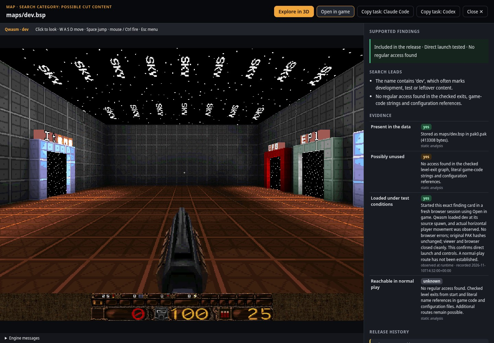

# From a finding card to a playable map

**LibreQuake v0.09-beta Lite, `maps/dev.bsp`: Included in the release · Direct launch
tested · No regular access found.**



This is an actual browser capture from the executed product test, not a mockup.
It shows the real Qwasm engine and the gallery's separate evidence panel.
“Possible cut content” is the search category. The three observations describe
what was established about this specific map.

## What supports each observation

| Observation | Actual check | Limit |
| --- | --- | --- |
| Included in the release | Both local PAK files matched the members of the official v0.09-beta Lite release ZIP by full SHA-256. `maps/dev.bsp` is inside `pak0.pak`. | Distribution of the data does not establish regular playable access. |
| Direct launch tested | In a fresh browser context, the exact map card's **Open in game** button started Qwasm on `dev`; actual horizontal player movement followed. | Direct start is a test condition. |
| No regular access found | No route was found in the checked exit graph starting at `start`, literal game-code name references or configuration references. | This is bounded static analysis. Additional routes remain possible. |

The primary publication source is the [official v0.09-beta release](https://github.com/lavenderdotpet/LibreQuake/releases/tag/v0.09-beta).
The checked Lite archive has SHA-256
`428e736b2f01d953e09a08c60bee975bdc4a0ac2219e97fa095c8af41754da83`.
The [public observation record](librequake-dev-observations.json) retains the
PAK hashes and actual runtime values without local machine paths or game data.

## The fresh-session product test

Executed on 2026-11-10 using the real local application and engine:

1. Start a new application test server and fresh browser context.
2. Open the actual game, preserve the investigation question in the copied
   agent task, and select the `maps/dev.bsp` finding card.
3. Open its actual decoded geometry, rotate it and check the visible source
   link and release scope.
4. Check the exact three observations, then click **Open in game** from
   this card.
5. Compare the engine's actual map and player position with the BSP's spawn.
   Wait without input, then hold **W** and check horizontal movement.
6. Close the viewer and browser, check for browser errors and compare source
   hashes again. Check that released map data is not labelled unreleased.

| Measurement | Observed value |
| --- | --- |
| BSP `info_player_start` | `[-1024, -688, 24]` |
| Actual initial player position, after settling on the floor | `[-1024, -688, 8.031]` |
| Without input | Same horizontal position |
| After pressing W | `[-175.862, -688, -23.969]` |
| Horizontal displacement | About 848 map units |
| Actual map | `dev` |
| JavaScript errors | None |
| Original PAK files | SHA-256 unchanged |

The vertical difference between the source spawn and initial runtime position
comes from the player settling onto the floor. The movement check uses the
horizontal axes, so gravity alone cannot satisfy it. The test records the real
engine's map, entity count, server time and player position; a screenshot change
alone is not the gameplay assertion.

## Reproduce locally

First follow [engine installation and verification](../GAME_LAUNCH.md). Install
Playwright and Chromium in your test environment. Use a private output directory
outside the checkout for generated scenes and test captures.

```sh
bin/cutcontent demo librequake
bin/cutcontent list --json
bin/cutcontent scan /path/to/librequake/id1
bin/cutcontent search BUILD --term maps/dev.bsp --kind map --json
```

Use the actual `BUILD` and `ITEM` identifiers returned on your machine. For the
shared-scene part of this test:

```sh
bin/cutcontent scene export BUILD ITEM /private/output/dev.scene.json --source-file /path/to/id1/pak0.pak --source-file /path/to/id1/pak1.pak
bin/cutcontent scene register BUILD ITEM /private/output/dev.scene.json
```

Inspect the official release and compare the local files before recording
`released` with scope `asset_distribution`. Execute the initial direct-start
test before recording `loaded_under_test=yes`, method `runtime`, access route
`direct_start`. Those observations supply the card's first two facts; they are
not automatically inferred from a filename or an installed engine.

Then run the exact fresh-card acceptance test:

```sh
python3 tests/browser_question_investigation_acceptance.py --build BUILD --item ITEM --source-file /path/to/id1/pak0.pak --source-file /path/to/id1/pak1.pak --output /private/output/fresh-card-test --play
```

The output directory must be new. Its final `report.json` must say `passed: true`.
The test uses actual game files and the installed, verified Qwasm build; it does
not substitute an engine mock. Its captures and machine-specific reports remain
private.

## Image and source notices

The screenshot contains LibreQuake artwork, distributed under BSD 3-Clause.
Full notices and upstream references are preserved in
[THIRD_PARTY_NOTICES.md](../../THIRD_PARTY_NOTICES.md). No game archive, map
export or engine binary is included in this demo documentation.
